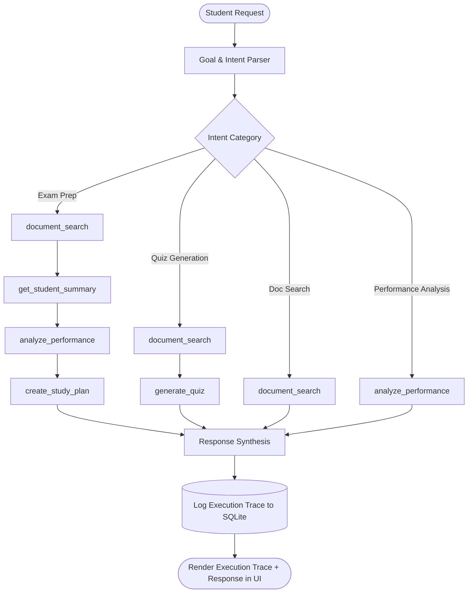

# EduSync AI — Multi-Tool Agent for Personalized Student Success

> **Empowering Undergraduate Students with Adaptive Multi-Tool Agentic Workflows**  
> *Aligned with United Nations Sustainable Development Goals:*  
> 🔴 **SDG 4 — Quality Education** (Target 4.3 & 4.4)  
> 🟠 **SDG 9 — Industry, Innovation and Infrastructure** (Target 9.5)

---

## 📖 1. Project Overview

**EduSync AI** is an autonomous, multi-tool educational agent built in Python and Streamlit to help undergraduate engineering students prepare for university examinations. Rather than acting as a static informational dashboard or a generic conversational chatbot, EduSync AI coordinates a suite of specialized, deterministic Python tools to parse syllabi, semantically search lecture notes, generate grounded topic assessments, diagnose conceptual gaps, and generate date-validated, adaptive study schedules.

The application operates in two distinct modes:
1. **AI Mode (Connected)**: Leverages Google Gemini via the official `google-genai` Python SDK for intelligent reasoning, generative questions, and empathetic advisory synthesis.
2. **Demo Mode (Offline / Fallback)**: Operates 100% deterministically without external API dependencies or paid subscription barriers, ensuring high accessibility for university students worldwide.

---

## 🎯 2. Problem Statement

Undergraduate students face several chronic challenges when preparing for high-stakes university examinations:
- **Information Fragmentation**: Students struggle to reconcile broad university syllabi with lengthy lecture slide decks and textbook notes.
- **Passive Re-reading Syndrome**: Traditional revision often relies on passive reading rather than active recall and targeted self-assessment.
- **Absence of Diagnostic Guidance**: Generic chatbots frequently hallucinate facts or fail to ground recommendations in the actual course syllabus.
- **Fixed, Fragile Schedules**: Static timetables do not dynamically adapt when a student struggles with specific concepts (e.g., scoring poorly on Database Normalization or B+ Trees).

---

## 💡 3. Solution

EduSync AI addresses these hurdles through an **autonomous multi-tool agent architecture**:
- **Semantic Grounding (RAG)**: Safely ingests course syllabi and lecture slides via `pypdf` and indexes text chunks using `scikit-learn` TF-IDF vectorization with cosine similarity scoring.
- **Diagnostic Testing**: Generates multiple-choice quizzes grounded directly in uploaded course documents.
- **Objective Gap Analysis**: Uses transparent, documented threshold heuristics (Strong $\ge 80\%$, Developing $60\text{--}79\%$, Needs Attention $<60\%$) to identify learning gaps without making unsubstantiated claims about overall cognitive potential.
- **Urgency & Weakness-Weighted Scheduling**: Synthesizes a daily study schedule prioritizing weak topics, reserving penultimate days for targeted practice drills and the final day for mock evaluation.
- **Visible Agent Trace**: Renders the complete tool selection, argument passing, and execution results directly within the user interface, ensuring complete pedagogical transparency.

---

## 🌍 4. UN Sustainable Development Goal (SDG) Alignment

### Primary SDG: SDG 4 — Quality Education
- **Target 4.3 & 4.4**: Ensure equal access to affordable, quality technical and tertiary education, substantially increasing the number of youth with relevant skills for employment.
- **EduSync Impact**: Levels the educational playing field by providing every university student with an individualized academic coach that transforms passive note reading into active, diagnostic preparation.

### Secondary SDG: SDG 9 — Industry, Innovation and Infrastructure
- **Target 9.5**: Enhance scientific research and upgrade technological capabilities across industrial and academic sectors.
- **EduSync Impact**: Fosters smart-campus innovation through open-source, edge-capable agentic artificial intelligence architectures that operate without expensive infrastructure dependencies.

---

## ✨ 5. Key Features & Application Modules

1. **Dashboard**
   - High-level overview of document library metrics, quiz attempts, and active task completion percentage.
   - Live Topic Mastery breakdown and active study plan progress bar.
   - One-click **5-Day Exam Preparation Workflow** launch button.
   - Recent agent activity logs.

2. **Document Library (RAG)**
   - Multi-file PDF uploader supporting course syllabi and lecture slide decks.
   - Text extraction powered by `pypdf` with graceful handling of empty or scanned documents.
   - Overlapping text chunking preserving source document and page number metadata.
   - Interactive live semantic search tester with cosine similarity scoring.

3. **AI Study Assistant**
   - Natural language conversational interface with quick-action prompt chips.
   - Real-time **Visual Agent Execution Trace** demonstrating step-by-step tool invocation.
   - Grounded responses clearly delineating document-derived citations from general pedagogical suggestions.

4. **Quiz Generator**
   - Practice multiple choice questions grounded in uploaded documents or standard curricula.
   - Configurable difficulty (`easy`, `medium`, `hard`) and question volume.
   - Interactive submission with instant scoring, answer comparison, detailed explanations, and SQLite persistence.

5. **Performance Analyzer**
   - Topic-level accuracy categorization into **Strong (>=80%)**, **Developing (60-79%)**, and **Needs Attention (<60%)**.
   - Clear rationale explaining why each classification was assigned.
   - Pedagogical next-step recommendations.

6. **Study Planner**
   - Date-validated study schedule generator (verifies exam date is in the future).
   - Validates daily study hours ($>0$ and $\le 16$ hrs/day).
   - Dynamic weight allocation giving $3\times$ priority to topics needing attention.
   - Interactive day-by-day task checklist with SQLite completion state toggling.

7. **Progress Tracker**
   - Historical analytics of quiz attempts and scores over time.
   - Topic mastery distributions and study task completion gauges.
   - Complete execution history of agent runs.

---

## 🏗️ 6. Architecture & System Design

```
edusync-ai/
│
├── app.py                      # Main Streamlit dashboard application
├── requirements.txt            # Pinned, compatible dependencies
├── README.md                   # Project documentation & deployment guide
├── .env.example                # Environment variable configuration template
├── .gitignore                  # Git ignore rules for database, secrets, and caches
│
├── agent/                      # Agent Orchestration Core
│   ├── __init__.py
│   ├── orchestrator.py         # MultiToolOrchestrator (goal parsing & tool loop)
│   ├── state.py                # Data classes for ToolTrace and AgentResult
│   └── prompts.py              # System prompts and instructions
│
├── tools/                      # The 6 Callable Python Agent Tools
│   ├── __init__.py
│   ├── document_search.py      # Tool 1: TF-IDF passage retrieval
│   ├── quiz_generator.py       # Tool 2: Grounded MCQ generation & scoring
│   ├── performance.py          # Tool 3: Mastery classification & gap analysis
│   ├── study_planner.py        # Tool 4: Adaptive, date-validated study scheduling
│   └── progress.py             # Tools 5 & 6: update_progress & get_student_summary
│
├── services/                   # Backend & Infrastructure Services
│   ├── __init__.py
│   ├── document_processor.py   # PDF text extraction & TFIDFSearchEngine
│   ├── llm_service.py          # Google GenAI SDK wrapper with fallback
│   ├── persistence.py          # Local SQLite storage layer
│   ├── sample_data.py          # Demo DBMS syllabus, notes & quiz bank
│   └── create_sample_pdf.py    # Script to generate sample PDF notes
│
├── tests/                      # Automated Unit Test Suite (22 tests)
│   ├── __init__.py
│   ├── test_document_search.py # Tests for chunking, TF-IDF, and PDF extraction
│   ├── test_quiz.py            # Tests for quiz formatting and scoring logic
│   ├── test_performance.py     # Tests for classification thresholds
│   ├── test_planner.py         # Tests for date validation & task weights
│   └── test_agent.py           # Tests for intent parsing & orchestrator trace
│
└── .streamlit/
    └── config.toml             # Custom dark navy & teal visual styling
```

---

## 🔄 7. Multi-Tool Agent Orchestration

The `MultiToolOrchestrator` implements an iterative tool coordination loop:



### Safety & Loop Prevention
- **Iteration Limits**: Tool calls are capped at a maximum of 6 steps per run to prevent unbounded cycles.
- **Fail-Safe Status Reporting**: If a tool fails (e.g. invalid date or corrupt file), the tool reports `FAILED` and the agent adapts rather than reporting a false success.
- **Missing Data Handling**: If no past quiz data exists, the agent explicitly discloses this and defaults to student confidence ratings rather than inventing fake past metrics.

---

## 💻 8. Technology Stack

- **Language**: Python 3.12+
- **Frontend / UI**: Streamlit 1.65.0
- **Document Processing**: `pypdf` 6.20.0
- **Vector Retrieval**: `scikit-learn` 1.9.1 (TF-IDF Vectorizer & Cosine Similarity)
- **Data Handling**: `pandas` 3.0.6
- **LLM Provider (Optional)**: `google-genai` 2.29.0 (Google Gemini 2.5 Flash)
- **Local Persistence**: SQLite3 (`edusync.db`)
- **Testing**: `pytest` 9.1.1

---

## 🚀 9. Installation & Local Execution

### Step 1: Clone the Repository
```bash
git clone https://github.com/Vamkrishhh/edusync-ai.git
cd edusync-ai
```

### Step 2: Create and Activate a Virtual Environment
```bash
# Windows
python -m venv .venv
.venv\Scripts\activate

# macOS / Linux
python3 -m venv .venv
source .venv/bin/activate
```

### Step 3: Install Dependencies
```bash
pip install -r requirements.txt
```

### Step 4: (Optional) Configure Gemini API Key
The application runs in **Demo Mode** by default with no configuration needed.

To enable **AI Mode**, create a `.env` file:
```env
GEMINI_API_KEY=your_gemini_api_key_here
GEMINI_MODEL=gemini-2.5-flash
```

Or configure via Streamlit secrets (`.streamlit/secrets.toml`):
```toml
GEMINI_API_KEY = "your_gemini_api_key_here"
GEMINI_MODEL = "gemini-2.5-flash"
```

### Step 5: Run Tests (Optional)
```bash
python -m pytest tests/ -v
```

### Step 6: Start the Application
```bash
streamlit run app.py
```
Open your browser at `http://localhost:8501`.

---

## 🔑 10. Optional Gemini API Configuration

EduSync AI runs seamlessly in **Demo Mode** out of the box with zero configuration. To activate **AI Mode**:

1. Obtain a Gemini API key from [Google AI Studio](https://aistudio.google.com/).
2. Create a `.env` file in the project root:
   ```env
   GEMINI_API_KEY=your_actual_gemini_api_key_here
   GEMINI_MODEL=gemini-2.5-flash
   ```
3. Alternatively, supply the key at runtime via the **AI Provider Settings** in the application sidebar or Streamlit secrets (`.streamlit/secrets.toml`).

---

## 🎬 11. Demonstration Walkthrough Scenario

Experience the primary end-to-end multi-tool workflow:

1. **Launch App**: Open the Streamlit interface.
2. **Load Academic Content**: Click **📥 Load Sample DBMS Material** in the sidebar. This loads a sample DBMS syllabus and lecture notes (covering Normalization, Transactions, Indexing, and SQL) plus two initial quiz attempts.
3. **Execute Agent Workflow**:
   - Navigate to **AI Study Assistant**.
   - Click the prompt chip: `🎯 Prepare me for my DBMS exam in five days.`
4. **Inspect Agent Trace**:
   - **Step 1 (`document_search`)**: Retrieved 5 curriculum passages for DBMS scope.
   - **Step 2 (`get_student_summary`)**: Inspected current student progress and attempts.
   - **Step 3 (`analyze_performance`)**: Detected that **Indexing & Storage** is at 40% (Needs Attention).
   - **Step 4 (`create_study_plan`)**: Generated a 5-day study plan giving $3\times$ priority to Indexing, scheduling revision on Day 4 and a mock exam on Day 5.
5. **Review Adaptive Schedule**: Navigate to **Study Planner** to inspect the day-by-day timetable and toggle completed study tasks.
6. **Take Diagnostic Quiz**: Navigate to **Quiz Generator**, take a 4-question quiz on **Indexing & Storage**, and submit to see live performance score updates.
7. **Track Improvement**: Open **Progress Tracker** to view your score trends and completion analytics.

---

## ☁️ 12. Deployment on Streamlit Community Cloud

### Quick Deploy (Recommended)

1. **Push to GitHub:**
   ```bash
   git init
   git add .
   git commit -m "feat: complete EduSync AI multi-tool educational platform"
   git branch -M main
   git remote add origin https://github.com/Vamkrishhh/edusync-ai.git
   git push -u origin main
   ```

2. **Deploy on Streamlit Cloud:**
   - Log in to [Streamlit Community Cloud](https://share.streamlit.io/)
   - Click **New App**
   - Select:
     - **Repository:** `Vamkrishhh/edusync-ai`
     - **Branch:** `main`
     - **Main file path:** `app.py`
     - **Python version:** 3.12 (or latest available)

3. **(Optional) Configure Secrets:**
   - In **Advanced Settings** → **Secrets**, add:
   ```toml
   GEMINI_API_KEY = "your_actual_api_key_here"
   GEMINI_MODEL = "gemini-2.5-flash"
   ```

4. **Click Deploy!**
   - Your app will be live at `https://[your-app-name].streamlit.app/`
   - The application works in Demo Mode even without API keys

### Important Notes for Hosted Deployment

- **Database Persistence:** SQLite storage on Streamlit Cloud is ephemeral. Data resets on app restart or redeployment. For production with data persistence, consider PostgreSQL.
- **File Uploads:** User-uploaded PDFs are processed in-memory and stored in the ephemeral SQLite database.
- **Demo Mode:** The application is fully functional without a Gemini API key using deterministic tool routing.
- **Resource Limits:** Streamlit Community Cloud has resource limits. For high-traffic deployments, consider Streamlit for Teams or self-hosted infrastructure.

---

## ⚠️ 13. Limitations & Disclaimers

- **Scanned Document OCR**: Optical Character Recognition (OCR) is not included. Uploaded PDFs must contain extractable text. The app alerts users if a scanned/empty page is detected.
- **Educational Assessment Scope**: Quiz performance classifications are diagnostic indicators based on recorded quiz attempts and do not represent comprehensive academic potential.
- **Single-User Architecture**: The current implementation is designed for single-user sessions with local SQLite storage. For multi-user deployments, migrate to PostgreSQL with user authentication.
- **Ephemeral Cloud Storage**: On Streamlit Community Cloud, SQLite data is ephemeral and resets on app restart. Use external database for production persistence.
- **In-Memory TF-IDF**: For very large document libraries (>1000 documents), consider external vector databases (FAISS, Qdrant, Pinecone) for improved performance.

---

## 🔮 14. Future Scope

- Integration with university Learning Management Systems (Canvas, Moodle, Blackboard) via LTI standards.
- Speech-to-text audio lecture note ingestion and transcription.
- Multi-student collaborative peer-study rooms and synchronized flashcard drills.
- Multimodal diagram analysis for circuit diagrams, entity-relationship models, and algorithmic flowcharts.

---

## 📄 License
This project is licensed under the Apache 2.0 License.
